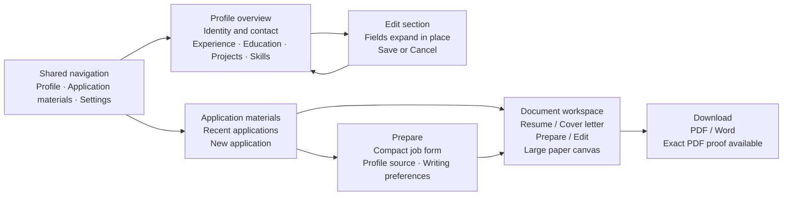

# Profile and Materials workspace brief

Status: design discovery complete; proposed layout for review. No application UI changes in this discovery round.

## Purpose and direction

Help applicants maintain accurate career facts, find their recent job-specific documents, and prepare another application quickly. Both pages use Impeccable's Operate mode. The user's primary concern is visual finish, followed by the current extension-settings character.

Confirmed preferences: spacious content with compact navigation; Profile opens with readable summaries and section-level Edit actions; sections expand into fields in place; Materials opens with recent jobs/documents and New application; motion stays subtle.

Keep DESIGN.md's graphite palette, Geist typography, restrained lime, precise feedback, and light document surface. Premium character comes from typography, alignment, spacing, clear surface hierarchy and complete interaction states.

## Profile

- Compact shared navigation connects Profile, Application materials and configuration. Configuration controls remain available but receive secondary emphasis.
- A restrained header establishes the career profile as the source for tailoring. Application materials remains directly accessible.
- Show readable identity/contact, experience, education, projects and skills summaries. Keep address, eligibility, preferences and disclosure details accessible through clearly labeled sections; do not remove any existing fields.
- Edit expands the selected section in place, with a clear save/cancel boundary and field-local validation. Preserve entered values, other section state and scroll context.
- Use actual saved data for completeness and missing-data notices. Avoid invented analytics, activity or match scores.

## Materials

- The landing page presents recent applications as spacious, scannable rows: role/company, available resume/letter, accurate document status and last update. New application is the dominant action.
- Opening an application leads to its document workspace. Global navigation, job context and document actions occupy predictable compact regions, leaving the paper canvas prominent.
- Retain independent Prepare/Edit and Resume/Cover letter controls. Show secondary controls on demand with visible entry points; keyboard and touch users must not rely on hover.
- New application uses the compact, aligned job-description form already requested, nearby title/company, accessible length choice and optional Writing preferences.
- Empty, generating, canceled, failed, missing-profile, locally saved and export-preparing states offer a useful next action. Preserve all existing draft, concurrency, rewrite and export guarantees.

## Interaction and responsive behavior

- Gentle control feedback, smooth section expansion and quiet save-status transitions. Motion conveys state and never delays typing, navigation or download.
- Maintain visible keyboard focus, stable focus after expansion, meaningful status announcements and reduced-motion support.
- On narrow screens, navigation compresses, summaries and recent application rows stack, and editing fields use the available width. Preserve readable document reflow and current zoom/PDF proof behavior.
- Use synthetic profile/job content in previews. Preview representative populated, inline-edit, empty/error and narrow-width states before judging the visual finish.

## Layout preview

## Delivery boundary

Continue on feature/materials-editor-ux. Reuse the existing plain-JavaScript extension, Tiptap, local assets, background persistence and validated PDF/Word pipeline. This brief does not authorize a new service, replacement editor, export-template redesign, fabricated career content or release. Build verification remains targeted under AGENTS.md.
